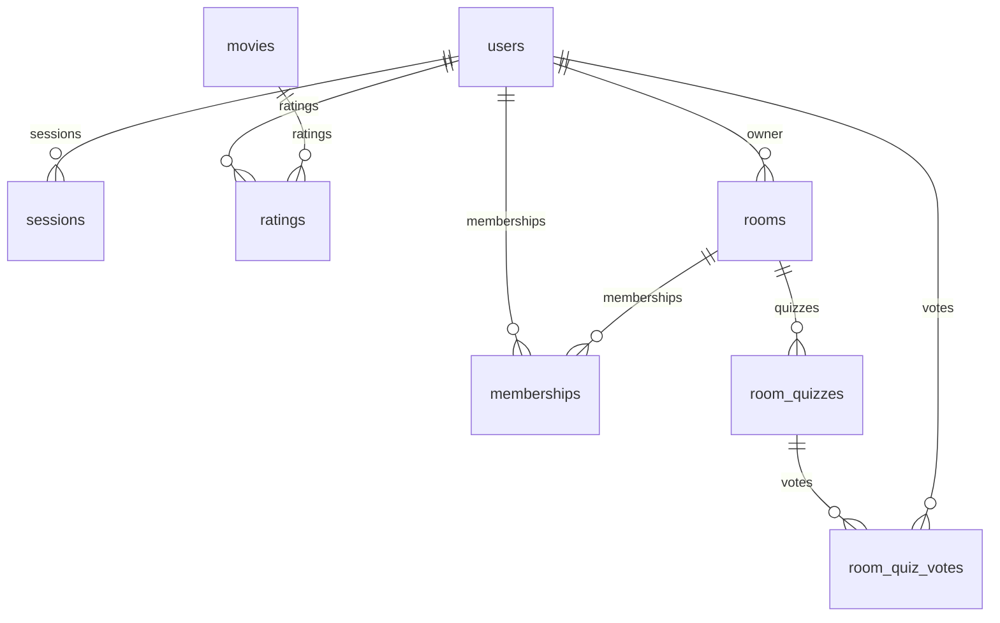

# Модели и бизнес-логика

Каталог хранит локальные фильмы с уникальным идентификатором TMDB. При первой оценке сведения о фильме загружаются с TMDB и сохраняются вместе с оценкой в транзакции. Повторное сохранение изменяет оценку текущего пользователя. Страницы фильма, «Мои оценки» и профиль показывают сохранённые данные. Комнаты создаются через интерфейс, а пользователи вступают по подписанной ссылке приглашения.

| Таблица | Поля предметной области | Ограничения |
| --- | --- | --- |
| users | email_address, nickname, password_digest | Обязательные поля; уникальные email и nickname |
| sessions | user_id, ip_address, user_agent | Обязательный внешний ключ пользователя |
| movies | tmdb_id, title, release_date | Обязательные название и положительный уникальный tmdb_id |
| ratings | user_id, movie_id, score | Внешние ключи; целая оценка 1–10; уникальная пара user_id/movie_id |
| rooms | name, owner_id, selection_filters, selection_results, selection_generated_at | Название 1–80 символов; внешний ключ владельца; JSON пожеланий и последней общей подборки |
| memberships | user_id, room_id | Внешние ключи; уникальная пара user_id/room_id |
| room_quizzes | room_id, started_by_id, status, participant_ids, candidates, initial_genre_weights, skipped_movie_ids, current_movie_id, selected_movie_id | Снимок участников и подборки; один активный квиз на комнату |
| room_quiz_votes | room_quiz_id, user_id, tmdb_id, choice | Один голос пользователя за фильм в квизе; choice: yes/no/unsure |

Все таблицы также содержат id, created_at, updated_at. release_date допускает отсутствие даты.

## Правила

- `Movie#average_rating` рассчитывает среднее по сохранённым оценкам конкретного фильма. Возвращает `nil`, если оценок нет, иначе число с сохранением дробной части.
- Пользователь может изменить свою оценку, но не создать вторую оценку того же фильма.
- `Room.create!` автоматически добавляет владельца в участники. Обе записи сохраняются в одной транзакции; ошибка создания участия откатывает комнату.
- `Room#add_member!(user)` возвращает новое или существующее участие. Блокировка комнаты сериализует вызовы метода, уникальный индекс дополнительно защищает от дубликатов.
- `Room#remove_member!(user)` удаляет участие. Повторное удаление возвращает `nil`. Удаление владельца через этот метод вызывает `Room::OwnerRemovalError`.
- При удалении фильма удаляются его оценки. При удалении комнаты удаляются её участия. При удалении пользователя удаляются его сессии, оценки, собственные комнаты и остальные участия.

Контроллер комнат ищет комнату только среди `Current.user.rooms`: просмотр, чтение результатов и запуск подбора доступны участникам. Приглашение содержит Rails signed ID с назначением `room_invitation`; простой ID комнаты или подпись с другим назначением не подходят. GET показывает приглашение, а POST добавляет текущего пользователя. Ссылка действует до удаления комнаты; отзыва и срока действия в первой версии нет. Передача владения пока не реализована.

`selection_filters` хранит последние пожелания по жанру, длительности и исключению оценённых фильмов. `selection_results` — до 12 результатов с данными фильма, баллом и объяснением. `selection_generated_at` отличает отсутствие подбора от выполненного подбора без результатов. Все три поля записываются одним обновлением после успешного обращения к TMDB; ошибка API сохраняет предыдущую подборку. Изменения оценок или состава комнаты учитываются при следующем запуске подбора.

`rooms.quiz_genre_weights` хранит отрицательные поправки от отказов в квизах этой комнаты. Они учитываются при следующих подборах и не меняют личные оценки. Голос, штраф и переход к следующему фильму сохраняются одной транзакцией под блокировкой комнаты. При удалении комнаты удаляются её квизы и голоса. Подробные [правила квиза](quiz.ru.md).

## Проверка

Применить миграцию: `ruby bin/rails db:migrate`.

Запустить тесты моделей: `ruby bin/rails test test/models`.

Запустить все тесты: `ruby bin/rails test`.

`movie_test.rb`: отсутствие оценок, одна оценка, дробное среднее и независимость фильмов.

`rating_test.rb`: границы диапазона, неверные значения, изменение и дублирование оценок, ограничения БД.

`room_test.rb`: участие владельца, откат транзакции, повторное добавление, удаление, защита владельца и очистка участий.
